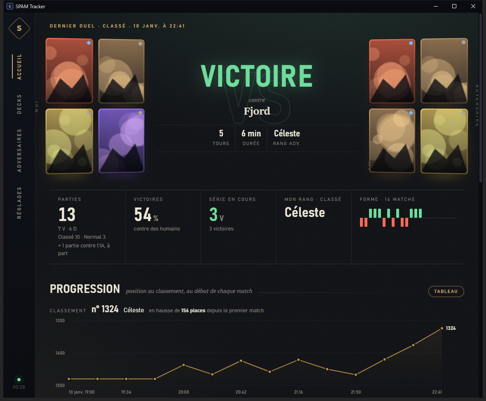
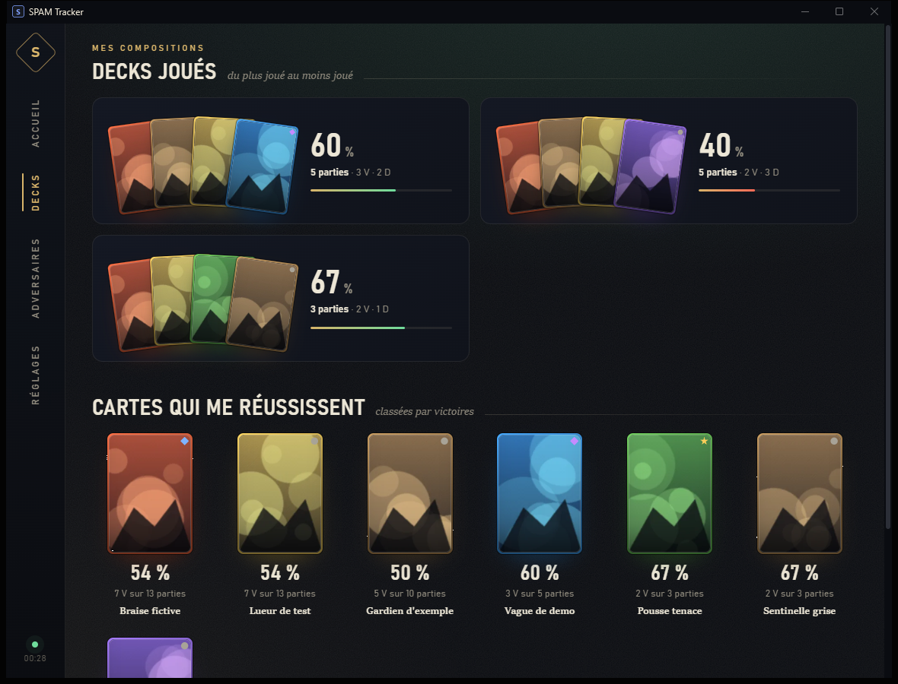
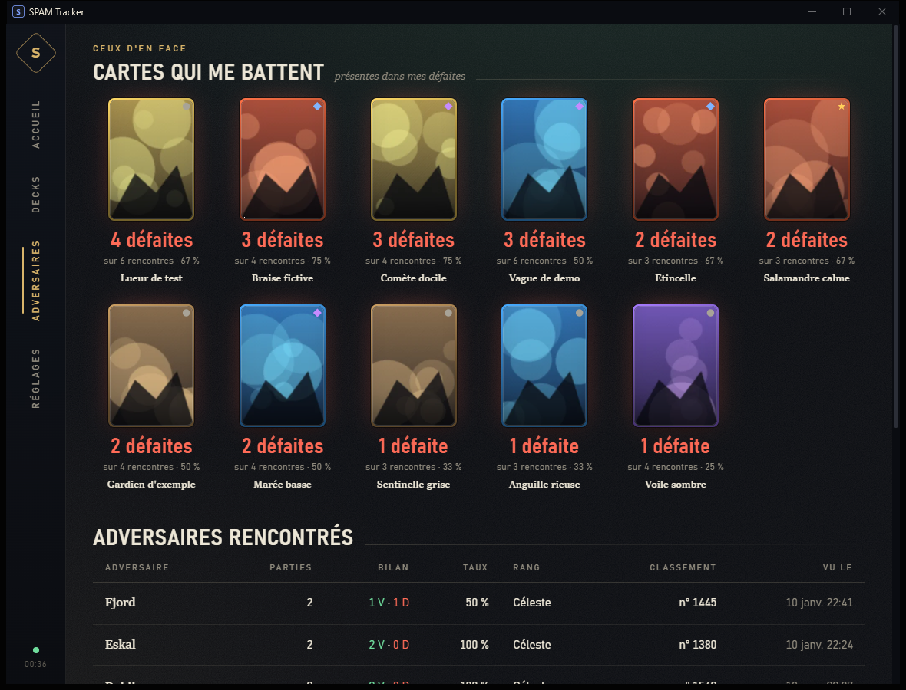
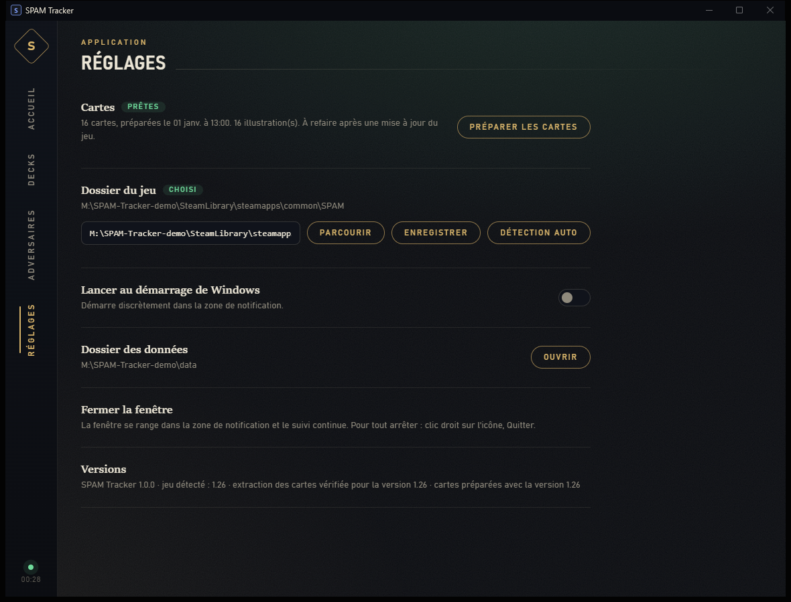

# SPAM Tracker

*[English version](README.en.md)*

Suivi de tes parties du jeu de cartes **SPAM** (Ticroco, Steam), sur Windows : résultats, decks,
adversaires, rang et évolution au classement, dans une application de bureau.

> **Projet de fan, non officiel.** SPAM Tracker n'est ni affilié à Ticroco, ni approuvé par eux.
> Le jeu, les noms des cartes, leurs données et leurs illustrations appartiennent à **Ticroco** et à
> leurs artistes. **Aucun contenu du jeu n'est distribué dans ce dépôt** : les noms et illustrations
> des cartes sont extraits sur ton ordinateur, depuis ta propre installation du jeu.



*Captures réalisées avec des données de démonstration entièrement fictives (pseudos, cartes et
illustrations inventés).*

## Ce que fait l'outil

- **Enregistre chaque match** dès qu'il se termine : résultat, mode (Normal, Classé...), decks des deux
  joueurs, nombre de tours, durée, adversaire, rang.
- **Garde tout l'historique** dans une base locale. Le jeu, lui, ne conserve que tes 10 derniers matchs.
- **Accueil** : le dernier match en face-à-face, ton bilan, ta série en cours, ta forme récente et
  l'évolution de ta position au classement.
- **Decks** : tes decks avec leur taux de victoire et les cartes qui te réussissent le plus.
- **Adversaires** : les cartes qui te battent le plus souvent et les joueurs rencontrés. Les parties
  contre l'IA sont mises à part.
- **Cartes illustrées** : après un clic sur "Préparer les cartes", les cartes s'affichent avec leur
  nom et leur illustration.
- Se range dans la **zone de notification** quand on ferme la fenêtre, et peut se lancer au démarrage
  de Windows.

| Decks | Adversaires | Réglages |
|---|---|---|
|  |  |  |

## Installation

Le guide pas à pas, pensé pour quelqu'un qui n'y connaît rien, est ici :
**[docs/INSTALLATION.md](docs/INSTALLATION.md)**.

En bref : télécharge `SPAM-Tracker.exe` depuis la page [**Releases**](https://github.com/Valaraukar56/Spam-Tracker/releases/latest), place-le dans un dossier à lui
(par exemple `Documents\SPAM Tracker`), lance-le, puis clique sur **Réglages > Préparer les cartes**.

## Comment ça marche (et ce que l'outil ne fait pas)

- **Il lit uniquement les fichiers que le jeu écrit sur ton disque** : après chaque match, SPAM écrit
  un résumé dans `%USERPROFILE%\AppData\LocalLow\Ticroco\Spam\replays\...\index.json`. SPAM Tracker
  surveille ce fichier et ajoute les nouveaux matchs à sa base.
- **"Préparer les cartes"** lit, en lecture seule, les fichiers de ton installation du jeu
  (`SPAM_Data\resources.assets`...). Il en fait une copie de travail temporaire, en extrait les
  noms et des miniatures, puis supprime la copie.
- **Aucune connexion réseau sortante.** L'interface est servie par un petit serveur local accessible
  uniquement depuis ton PC (`127.0.0.1:8765`). Il refuse les requêtes venant d'autres sites.
- **Il ne modifie pas le jeu**, n'injecte rien, **ne lit pas sa mémoire** et n'intercepte pas son
  trafic. Il ne peut donc pas être vu comme de la triche.
- **Confidentialité** : l'identifiant de ton compte (AccountId) et le ticket de connexion présents
  dans les fichiers du jeu ne sont **ni enregistrés ni affichés**. Les replays `.srpl` du jeu ne
  sont pas copiés.
- **Toutes les données restent dans le dossier de l'application** : `spam.db` (tes matchs),
  `catalog.json` et `cards\` (les cartes), `settings.json`, `tracker.log` et `webview-cache\`.

## Compiler soi-même

Pour ne pas avoir à faire confiance à l'exe publié, tu peux le reconstruire depuis ce code.

Prérequis : Windows 10 ou 11, [Python 3.13](https://www.python.org/downloads/windows/).

```powershell
git clone https://github.com/Valaraukar56/Spam-Tracker.git
cd Spam-Tracker
py -3.13 -m venv .venv
.\.venv\Scripts\python.exe -m pip install -r requirements.txt
powershell -ExecutionPolicy Bypass -File build.ps1
```

Le résultat est dans `dist\` : `SPAM-Tracker.exe` et `SHA256SUMS.txt`. Tu peux aussi lancer
l'application sans compiler : `.\.venv\Scripts\python.exe app.py`.

Autres outils pour les curieux :

- `python tracker.py stats` et `python tracker.py decks` : statistiques dans la console ;
- `python extract_catalog.py --images` : préparation des cartes en ligne de commande ;
- `python tools\make_demo.py <dossier>` : données 100 % fictives pour tester ou faire des captures.

## Limites connues

- **Le jeu ne garde que tes 10 derniers matchs.** SPAM Tracker doit tourner pendant que tu joues, ou
  au moins être lancé avant d'avoir joué 10 nouvelles parties, sinon les plus anciennes sont perdues.
  Active "Lancer au démarrage de Windows" pour ne pas y penser.
- **La préparation des cartes peut casser après une mise à jour du jeu.** Le format interne des
  cartes a été décodé à la main pour la version **1.26** du jeu. L'application affiche un
  avertissement si la version change. Sans catalogue, elle reste utilisable : les cartes
  s'affichent alors par leur identifiant.
- **Windows uniquement** (10 et 11).
- **Non décodé** : le déroulé coup par coup des replays (`.srpl`), les descriptions des capacités,
  et une valeur numérique de chaque carte dont le rôle est inconnu.
- **Rang** : il est déduit des données du mode Classé enregistrées par le jeu au début de chaque
  match. En mode Normal, il ne change pas.
- La préparation des cartes demande environ **2,5 Go d'espace libre temporaire** sur le disque où se
  trouve l'application, et quelques minutes.

## Dépannage

**Le tracker ne détecte pas mes matchs**
- Vérifie que SPAM Tracker tourne (icône dans la zone de notification, près de l'horloge).
- Un match n'apparaît qu'**une fois terminé**, quelques secondes après l'écran de fin.
- Le bandeau "Aucun match SPAM trouvé" indique que le dossier `AppData\LocalLow\Ticroco\Spam\replays`
  n'existe pas encore : joue une partie complète.
- Consulte `tracker.log` dans le dossier de l'application.

**Les images des cartes manquent**
- Va dans **Réglages > Préparer les cartes**. Après une mise à jour du jeu, refais-le.
- Si le jeu n'est pas trouvé, indique son dossier dans **Réglages > Dossier du jeu** (dans Steam :
  clic droit sur SPAM > Gérer > Parcourir les fichiers locaux).
- En cas d'échec, le message affiché et `tracker.log` donnent la raison (place disque, format du jeu
  changé...).

**L'antivirus bloque ou supprime l'exe**
- Les exe créés avec PyInstaller et non signés sont parfois signalés à tort.
- Vérifie l'empreinte SHA-256 (voir le guide d'installation). Si elle correspond, tu peux
  autoriser le fichier dans ton antivirus, ou **compiler toi-même**.

**Message "WebView2 est absent"**
- L'interface utilise Microsoft Edge WebView2, déjà présent sur Windows 11 et sur la plupart des
  Windows 10. Sinon, le tableau de bord s'ouvre dans ton navigateur et tout fonctionne quand même.
- Pour avoir la fenêtre intégrée, installe "Microsoft Edge WebView2 Runtime" depuis le site de
  Microsoft.

## Licence et mentions

- Code : licence **MIT** (voir [LICENSE](LICENSE)). La licence ne couvre pas le contenu du jeu.
- SPAM, ses cartes et ses illustrations : © Ticroco et leurs artistes.
- Sécurité et données personnelles : voir [SECURITY.md](SECURITY.md). Ne publie jamais ton
  `index.json`, tes `.srpl` ni ton `spam.db`.
